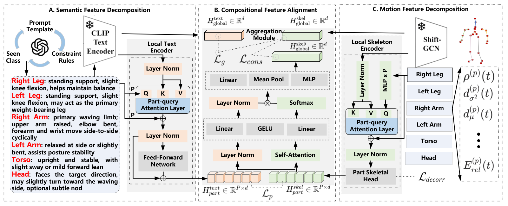

# Generalized Zero-Shot Skeleton Action Recognition with Compositional Motion-Attribute Primitives

Jinlong Wang, Xuan Liu, Bin Lyu, Jinchao Ge, and Jiahui Yu



The skeleton branch encodes motion attributes for six body parts and aggregates the resulting primitives with attention. The text branch uses frozen CLIP ViT-B/32 to construct global and part-level semantic anchors. Training uses separate primitive and global alignment losses, compositional consistency, and primitive decorrelation. Inference L2-normalizes the aggregated feature and scores it against the global text anchors for the joint seen/unseen label space.

## Installation

```bash
git clone https://github.com/daf917/gzsl-skeleton.git
cd gzsl-skeleton
pip install -r requirements.txt
```

Use Python 3.10 or later. CLIP downloads the ViT-B/32 weights on first use. CUDA is recommended for training.

## Train and evaluate a split

Prepare the 2D skeletons and sample assignments described in [Reproducibility materials](docs/reproducibility_materials.md). Use the same class split and preprocessed data for all three commands.

```bash
python scripts/pretrain_shift_gcn.py --config config/config.yaml --split-protocol random --split-index 1 --data-file data/ntu60/random_split_1.npz
python scripts/train.py --config config/config.yaml --split-protocol random --split-index 1 --data-file data/ntu60/random_split_1.npz
python scripts/test.py --config config/config.yaml --split-protocol random --split-index 1 --data-file data/ntu60/random_split_1.npz --checkpoint checkpoints/ntu60/random_split_1/model.pth --metrics-output random_split_1.json
```

Shift-GCN is pretrained on the labeled training samples of the seen classes and then frozen. The recognition model uses 64 frames, 512-dimensional embeddings, AdamW for 80 epochs, batch size 64, an initial learning rate of 0.0001, and weight decay of 0.0005. The contrastive temperature is 0.07. The primitive alignment, global alignment, compositional consistency, and primitive decorrelation weights are 1.0, 1.0, 0.5, and 0.1, respectively.

Run splits 1–3 separately for each dataset and protocol. Put their result objects in the `splits` array of a JSON object with `dataset` and `protocol` fields.

```bash
python scripts/test.py --aggregate-split-results split_metrics.json
```

The aggregation first averages the unrounded seen and unseen accuracies across the three splits and then computes their harmonic mean. Use a separate file per method, dataset, and split protocol.

## Few-shot evaluation

Use a prepared HMDB-51 or SSv2 NPZ with separate support (`split=1`) and query (`split=2`) partitions and distinct sample IDs. The prototype evaluator uses a fixed seed and 2, 4, 8, or 16 support examples per class.

```bash
python scripts/test_few_shot.py --dataset hmdb51 --data-file path/to/hmdb51.npz --checkpoint path/to/model.pth --num-shots 16 --seed 42
```

Use a checkpoint trained with compatible 17-joint inputs. Reported few-shot results below use the manuscript's benchmark runs.

## Results reported in the manuscript

| Dataset | Split | Seen (%) | Unseen (%) | HM (%) |
|---|---|---:|---:|---:|
| NTU60 | 3 random, 55/5 | 78.5 | 81.2 | 79.8 |
| NTU120 | 3 random, 110/10 | 63.4 | 77.6 | 69.8 |
| UCF101 | 3 random, 80/21 | 96.1 | 83.7 | 89.5 |
| UCF101 | 3 provided, 80/21 | 95.6 | 84.0 | 89.4 |
| PKU-MMD | 3 random, 46/5 | 70.8 | 62.0 | 66.1 |
| PKU-MMD | 3 provided, 46/5 | 76.8 | 63.9 | 69.8 |

| Few-shot dataset | 2-shot | 4-shot | 8-shot | 16-shot |
|---|---:|---:|---:|---:|
| HMDB-51 | 59.4 | 65.2 | 68.7 | 71.3 |
| SSv2 | 8.2 | 10.1 | 11.8 | 15.4 |

DVTA reports higher accuracy on all four SSv2 shot settings.

## Citation

```bibtex
@unpublished{wang_compositional_motion_primitives,
  title={Generalized Zero-Shot Skeleton Action Recognition with Compositional Motion-Attribute Primitives},
  author={Wang, Jinlong and Liu, Xuan and Lyu, Bin and Ge, Jinchao and Yu, Jiahui},
  note={Manuscript}
}
```

## License and acknowledgments

This project is distributed under the [MIT License](LICENSE). The backbone follows the spatial and temporal shift operations of [Shift-GCN](https://github.com/kchengiva/Shift-GCN). The text encoder uses [CLIP](https://github.com/openai/CLIP).
